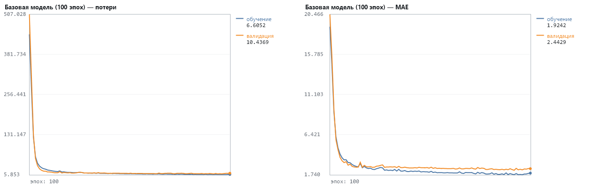
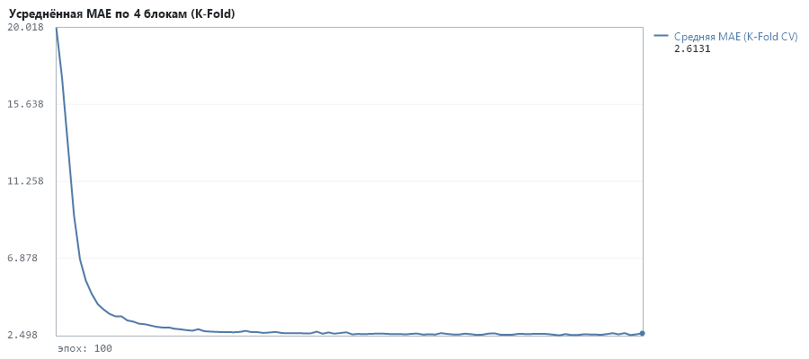
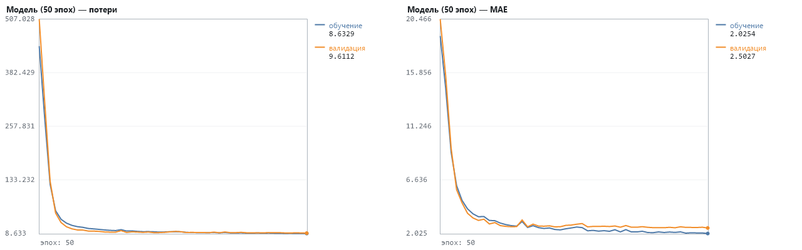

# Лабораторная: регрессия — цены на жильё в Бостоне (Boston Housing)

## 3. Загрузка и анализ данных

Форма обучающих данных: (404, 13), тестовых: (102, 13); меток: (404,) и (102,). Разбиение 80/20 как в keras.datasets.boston_housing (seed 42).

Первые 5 цен в обучающем наборе: [5.0, 23.8, 9.5, 20.6, 14.5] (тыс. $)

Диапазон цен: 5.0 – 50.0 тыс. $

| До нормализации | Среднее | Ст. отклонение |
|---|---|---|
| CRIM | 3.896 | 9.299 |
| ZN | 11.354 | 23.690 |
| INDUS | 11.365 | 6.893 |
| CHAS | 0.072 | 0.258 |
| NOX | 0.557 | 0.116 |


## 4. Предобработка: нормализация (z-score по обучающей выборке)

μ и σ считаются только по обучающей выборке и применяются к обеим — статистика теста заранее неизвестна.

| После нормализации (≈0 и ≈1) | Среднее | Ст. отклонение |
|---|---|---|
| CRIM | -0.000 | 1.000 |
| ZN | 0.000 | 1.000 |
| INDUS | 0.000 | 1.000 |
| CHAS | 0.000 | 1.000 |
| NOX | 0.000 | 1.000 |


## 5–6. Базовая модель: 13 → 64 → 64 → 1 (relu, linear), rmsprop, mse, метрика mae

**Базовая модель (100 эпох)**: скрытые слои [64, 64], optimizer='rmsprop' (lr 0.001), loss: regression (linear + MSE), epochs=100, batch_size=16, признаки: z-score

```
_________________________________________________________________
 Layer (type)                  Output Shape        Param #
=================================================================
 dense (Dense, relu)           (None, 64)          896
 dense_1 (Dense, relu)         (None, 64)          4,160
 dense_2 (Dense, linear)       (None, 1)           65
=================================================================
Total params: 5,121
Trainable params: 5,121
Non-trainable params: 0
_________________________________________________________________
```

evaluate (валидация/тест): loss 10.4369, mae 2.443; train: loss 6.6052, mae 1.924; время 0.39 с



--- Оценка модели «Базовая модель (100 эпох)» на тестовых данных --- Среднеквадратичная ошибка (MSE): 10.44; средняя абсолютная ошибка (MAE): 2.44 = $2,443


## 8. Эксперимент: K-Fold перекрёстная проверка (K = 4)



Средняя MAE за последние 10 эпох (K-Fold): 2.5677 ($2,568); MAE блоков: [2.34, 2.66, 3.11, 2.34], σ = 0.32.


## 9. Эксперимент: изменение количества эпох (50)

**Модель (50 эпох)**: скрытые слои [64, 64], optimizer='rmsprop' (lr 0.001), loss: regression (linear + MSE), epochs=50, batch_size=16, признаки: z-score

evaluate (валидация/тест): loss 9.6112, mae 2.503; train: loss 8.6329, mae 2.025; время 0.18 с



--- Оценка модели «Модель (50 эпох)» на тестовых данных --- Среднеквадратичная ошибка (MSE): 9.61; средняя абсолютная ошибка (MAE): 2.50 = $2,503


## 10. Сравнение и анализ результатов

| Модель | Архитектура | Оптимизатор | Эпох | Batch | Параметров | train mae | val mae | лучшая val mae (эпоха) | мин. val_loss (эпоха) | Время |
|---|---|---|---|---|---|---|---|---|---|---|
| Базовая модель (100 эпох) | 13 → 64 → 64 → 1 | rmsprop | 100 | 16 | 5,121 | 1.924 | 2.443 | 2.258 (92) | 8.2507 (92) | 0.39 с |
| Модель (50 эпох) | 13 → 64 → 64 → 1 | rmsprop | 50 | 16 | 5,121 | 2.025 | 2.503 | 2.503 (50) | 9.6112 (50) | 0.18 с |

| Оценка | MAE | MAE, $ |
|---|---|---|
| Базовая модель, тест (100 эпох) | 2.44 | $2,443 |
| Модель 50 эпох, тест | 2.50 | $2,503 |
| K-Fold, среднее последних 10 эпох | 2.57 | $2,568 |

- Где начинается переобучение: у базовой модели val_mae минимальна на эпохе 92 (2.26), val_loss — на эпохе 92; к последней эпохе val_mae 2.44, train_mae 1.92. Диагноз по кривым — Базовая модель (100 эпох): явных признаков переобучения нет: val_loss к концу обучения у своего минимума; разрыв MAE val−train 0.519
- Стабильность K-Fold: MAE отдельных блоков различаются (σ = 0.32 тыс. $) — ровно настолько «гуляла» бы оценка по одной случайной тестовой выборке из ~100 домов. Среднее по 4 блокам надёжнее одиночного evaluate.
- Влияние числа эпох: 50 эпох → MAE 2.50, 100 эпох → 2.44. «Модель (50 эпох)»: val mae 2.503 против 2.443 у «Базовая модель (100 эпох)» (+0.060, хуже); время 0.18 с против 0.39 с.

Замечание к методике: в листинге validation_data = тестовая выборка, поэтому выбор числа эпох по её графику — подглядывание в тест. Честнее подбирать эпохи по K-Fold на обучающей выборке и только в конце один раз оценить модель на тесте.

Модель «Базовая модель (100 эпох)» сохранена в boston_model.nn (20,660 байт, нормализатор внутри) и загружена заново: val mae на сырых признаках = 2.443 — совпадает с исходной моделью.

