# Лабораторная: классификация цветков ириса (Iris, многоклассовая классификация)

## 1. Загрузка и анализ данных (листинги 1–3)

Датасет: 150 образцов, X: (150, 4) — sepal/petal length/width в см, Y: (150,) — вид ириса.

```
5.1, 3.5, 1.4, 0.2, Iris-setosa
4.9, 3.0, 1.4, 0.2, Iris-setosa
4.7, 3.2, 1.3, 0.2, Iris-setosa
```


## 2. Кодирование меток: LabelEncoder → one-hot (листинги 4–5)

| Исходная метка | encoded_Y | Вектор кодировки (dummy_y) | Образцов |
|---|---|---|---|
| Iris-setosa | 0 | [1, 0, 0] | 50 |
| Iris-versicolor | 1 | [0, 1, 0] | 50 |
| Iris-virginica | 2 | [0, 0, 1] | 50 |

Разбиение: train 120 / validation 30 (20%, seed 42). В Keras validation_split берёт последние 20% строк без перемешивания — в отсортированном iris.csv это были бы только Iris-virginica, и val_accuracy ничего бы не говорила. Поэтому строки перемешиваются до разбиения.

dummy_y: (120, 3); признаки подаются как есть, без нормализации — как в листинге.


## 3. Базовая модель (листинги 6–7): Dense(8, relu) → Dense(3, softmax)

**Базовая 4-8-3**: скрытые слои [8], optimizer='adam' (lr 0.001), loss: multi-class (softmax + categorical CE), epochs=150, batch_size=10, признаки: без нормализации

```
_________________________________________________________________
 Layer (type)                  Output Shape        Param #
=================================================================
 dense (Dense, relu)           (None, 8)           40
 dense_1 (Dense, softmax)      (None, 3)           27
=================================================================
Total params: 67
Trainable params: 67
Non-trainable params: 0
_________________________________________________________________
```

evaluate (валидация/тест): loss 0.1158, accuracy 100.0 %; train: loss 0.1640, accuracy 97.5 %; время 0.14 с

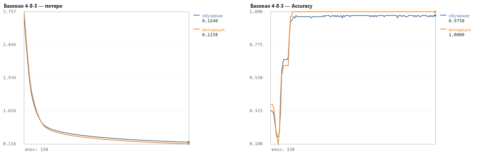


## 4. Эксперименты: нейроны, слои, batch_size, оптимизаторы, эпохи, нормализация

**4 нейрона (исходный листинг)**: скрытые слои [4], optimizer='adam' (lr 0.001), loss: multi-class (softmax + categorical CE), epochs=150, batch_size=10, признаки: без нормализации

evaluate (валидация/тест): loss 1.0962, accuracy 20.0 %; train: loss 1.0891, accuracy 24.2 %; время 0.07 с

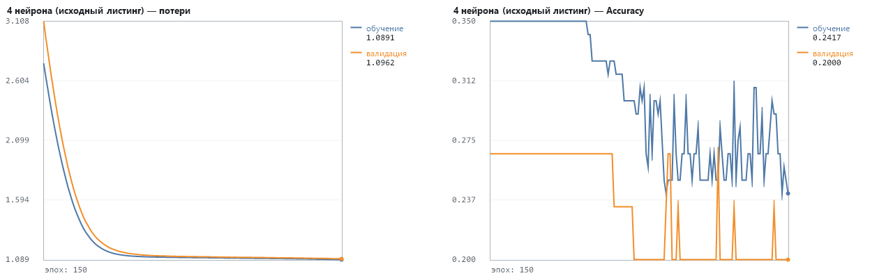

**16 нейронов**: скрытые слои [16], optimizer='adam' (lr 0.001), loss: multi-class (softmax + categorical CE), epochs=150, batch_size=10, признаки: без нормализации

evaluate (валидация/тест): loss 0.1016, accuracy 100.0 %; train: loss 0.1535, accuracy 96.7 %; время 0.17 с

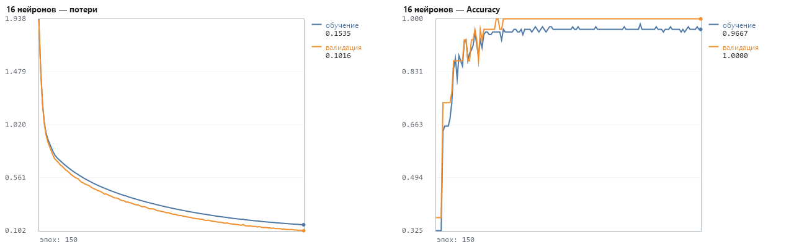

**Два слоя 8-8**: скрытые слои [8, 8], optimizer='adam' (lr 0.001), loss: multi-class (softmax + categorical CE), epochs=150, batch_size=10, признаки: без нормализации

evaluate (валидация/тест): loss 0.0373, accuracy 100.0 %; train: loss 0.0873, accuracy 97.5 %; время 0.07 с

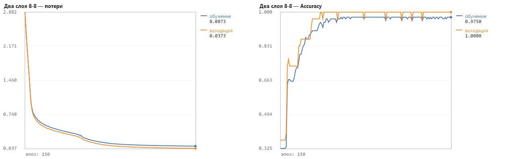

**batch 5**: скрытые слои [8], optimizer='adam' (lr 0.001), loss: multi-class (softmax + categorical CE), epochs=150, batch_size=5, признаки: без нормализации

evaluate (валидация/тест): loss 0.0496, accuracy 100.0 %; train: loss 0.1006, accuracy 96.7 %; время 0.05 с

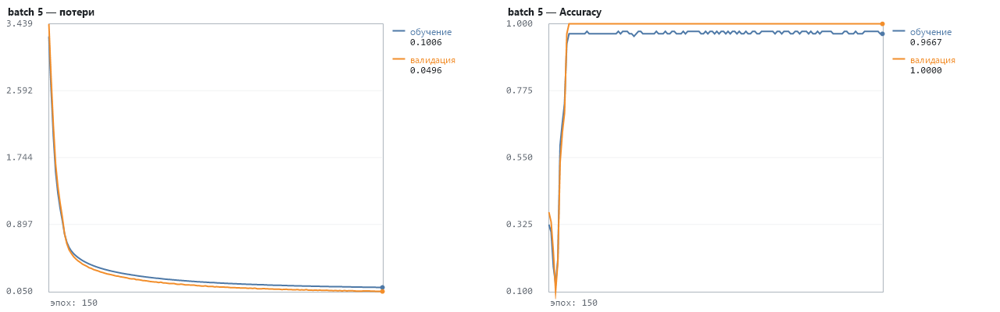

**batch 32**: скрытые слои [8], optimizer='adam' (lr 0.001), loss: multi-class (softmax + categorical CE), epochs=150, batch_size=32, признаки: без нормализации

evaluate (валидация/тест): loss 0.2681, accuracy 100.0 %; train: loss 0.3149, accuracy 96.7 %; время 0.02 с

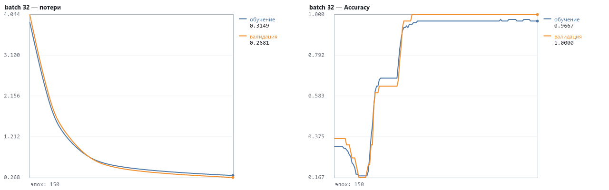

**rmsprop**: скрытые слои [8], optimizer='rmsprop' (lr 0.001), loss: multi-class (softmax + categorical CE), epochs=150, batch_size=10, признаки: без нормализации

evaluate (валидация/тест): loss 0.0760, accuracy 96.7 %; train: loss 0.1168, accuracy 96.7 %; время 0.02 с

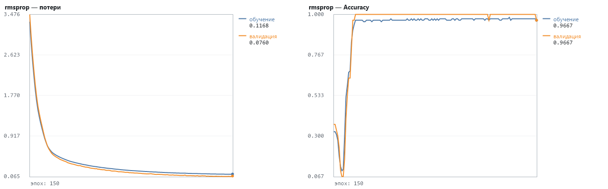

**sgd**: скрытые слои [8], optimizer='sgd' (lr 0.01), loss: multi-class (softmax + categorical CE), epochs=150, batch_size=10, признаки: без нормализации

evaluate (валидация/тест): loss 0.1044, accuracy 96.7 %; train: loss 0.1410, accuracy 92.5 %; время 0.02 с

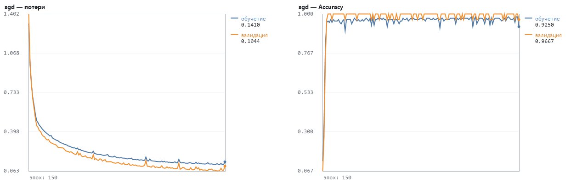

**500 эпох**: скрытые слои [8], optimizer='adam' (lr 0.001), loss: multi-class (softmax + categorical CE), epochs=500, batch_size=10, признаки: без нормализации

evaluate (валидация/тест): loss 0.0274, accuracy 100.0 %; train: loss 0.0749, accuracy 96.7 %; время 0.07 с

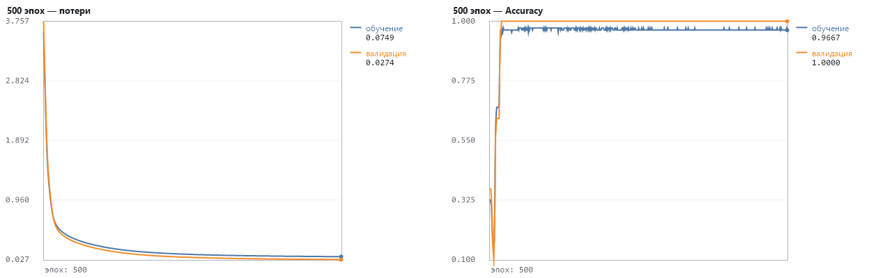

**z-score нормализация**: скрытые слои [8], optimizer='adam' (lr 0.001), loss: multi-class (softmax + categorical CE), epochs=150, batch_size=10, признаки: z-score

evaluate (валидация/тест): loss 0.0580, accuracy 100.0 %; train: loss 0.1195, accuracy 96.7 %; время 0.03 с

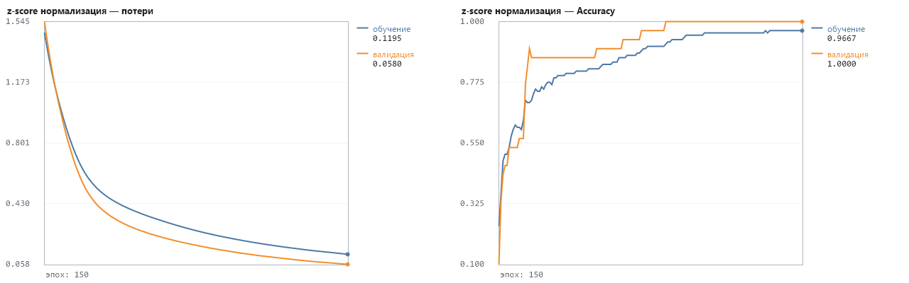


## 5. Сравнение моделей и выбор лучшей (требование 4)

| Модель | Архитектура | Оптимизатор | Эпох | Batch | Параметров | train accuracy | val accuracy | лучшая val accuracy (эпоха) | мин. val_loss (эпоха) | Время |
|---|---|---|---|---|---|---|---|---|---|---|
| Базовая 4-8-3 | 4 → 8 → 3 | adam | 150 | 10 | 67 | 97.5 % | 100.0 % | 100.0 % (21) | 0.1158 (150) | 0.14 с |
| 4 нейрона (исходный листинг) | 4 → 4 → 3 | adam | 150 | 10 | 35 | 24.2 % | 20.0 % | 26.7 % (1) | 1.0962 (150) | 0.07 с |
| 16 нейронов | 4 → 16 → 3 | adam | 150 | 10 | 131 | 96.7 % | 100.0 % | 100.0 % (35) | 0.1016 (150) | 0.17 с |
| Два слоя 8-8 | 4 → 8 → 8 → 3 | adam | 150 | 10 | 139 | 97.5 % | 100.0 % | 100.0 % (36) | 0.0373 (150) | 0.07 с |
| batch 5 | 4 → 8 → 3 | adam | 150 | 5 | 67 | 96.7 % | 100.0 % | 100.0 % (10) | 0.0496 (150) | 0.05 с |
| batch 32 | 4 → 8 → 3 | adam | 150 | 32 | 67 | 96.7 % | 100.0 % | 100.0 % (58) | 0.2681 (150) | 0.02 с |
| rmsprop | 4 → 8 → 3 | rmsprop | 150 | 10 | 67 | 96.7 % | 96.7 % | 100.0 % (17) | 0.0645 (144) | 0.02 с |
| sgd | 4 → 8 → 3 | sgd | 150 | 10 | 67 | 92.5 % | 96.7 % | 100.0 % (5) | 0.0629 (144) | 0.02 с |
| 500 эпох | 4 → 8 → 3 | adam | 500 | 10 | 67 | 96.7 % | 100.0 % | 100.0 % (21) | 0.0274 (500) | 0.07 с |
| z-score нормализация | 4 → 8 → 3 | adam | 150 | 10 | 67 | 96.7 % | 100.0 % | 100.0 % (83) | 0.0580 (150) | 0.03 с |

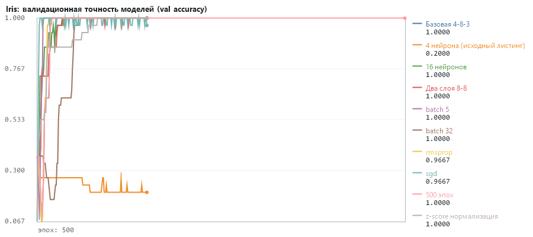

- «4 нейрона (исходный листинг)»: val accuracy 20.0 % против 100.0 % у «Базовая 4-8-3» (-80.0 п.п., хуже); время 0.07 с против 0.14 с.
- «16 нейронов»: val accuracy 100.0 % против 100.0 % у «Базовая 4-8-3» (0.0 п.п., без изменений); время 0.17 с против 0.14 с.
- «Два слоя 8-8»: val accuracy 100.0 % против 100.0 % у «Базовая 4-8-3» (0.0 п.п., без изменений); время 0.07 с против 0.14 с.
- «batch 5»: val accuracy 100.0 % против 100.0 % у «Базовая 4-8-3» (0.0 п.п., без изменений); время 0.05 с против 0.14 с.
- «batch 32»: val accuracy 100.0 % против 100.0 % у «Базовая 4-8-3» (0.0 п.п., без изменений); время 0.02 с против 0.14 с.
- «rmsprop»: val accuracy 96.7 % против 100.0 % у «Базовая 4-8-3» (-3.3 п.п., хуже); время 0.02 с против 0.14 с.
- «sgd»: val accuracy 96.7 % против 100.0 % у «Базовая 4-8-3» (-3.3 п.п., хуже); время 0.02 с против 0.14 с.
- «500 эпох»: val accuracy 100.0 % против 100.0 % у «Базовая 4-8-3» (0.0 п.п., без изменений); время 0.07 с против 0.14 с.
- «z-score нормализация»: val accuracy 100.0 % против 100.0 % у «Базовая 4-8-3» (0.0 п.п., без изменений); время 0.03 с против 0.14 с.

Переобучение:

- Базовая 4-8-3: явных признаков переобучения нет: val_loss к концу обучения у своего минимума; разрыв accuracy train−val -2.5 п.п.
- 4 нейрона (исходный листинг): модель не обучилась — точность на обучении 24.2 % на уровне случайного угадывания (1/3); потери 2.7524 → 1.0891. Типичная причина — «мёртвые» ReLU: при положительном ненормализованном входе скрытые нейроны уходят в z < 0 и перестают получать градиент; лечится нормализацией входа или другим seed/learning rate; разрыв accuracy train−val 4.2 п.п.
- 16 нейронов: явных признаков переобучения нет: val_loss к концу обучения у своего минимума; разрыв accuracy train−val -3.3 п.п.
- Два слоя 8-8: явных признаков переобучения нет: val_loss к концу обучения у своего минимума; разрыв accuracy train−val -2.5 п.п.
- batch 5: явных признаков переобучения нет: val_loss к концу обучения у своего минимума; разрыв accuracy train−val -3.3 п.п.
- batch 32: явных признаков переобучения нет: val_loss к концу обучения у своего минимума; разрыв accuracy train−val -3.3 п.п.
- rmsprop: явных признаков переобучения нет: val_loss к концу обучения у своего минимума; разрыв accuracy train−val 0.0 п.п.
- sgd: явных признаков переобучения нет: val_loss к концу обучения у своего минимума; разрыв accuracy train−val -4.2 п.п.
- 500 эпох: явных признаков переобучения нет: val_loss к концу обучения у своего минимума; разрыв accuracy train−val -3.3 п.п.
- z-score нормализация: явных признаков переобучения нет: val_loss к концу обучения у своего минимума; разрыв accuracy train−val -3.3 п.п.

**Лучшая модель: «500 эпох»** (4 → 8 → 3) — val accuracy 100.0 %, val_loss 0.0274. Критерий — финальная валидационная точность; при равенстве меньший val_loss (модель увереннее в верных ответах), затем меньше параметров. С валидацией в 30 образцов многие модели дают 100% — различия в пределах 1 образца (3.3 п.п.) статистически незначимы.

Модель «500 эпох» сохранена в iris_best.nn (315 байт, нормализатор внутри) и загружена заново: val accuracy на сырых признаках = 100.0 % — совпадает с исходной моделью.

