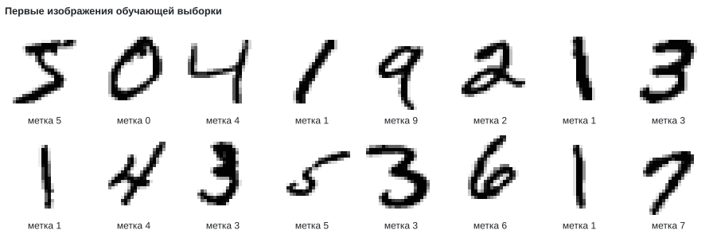
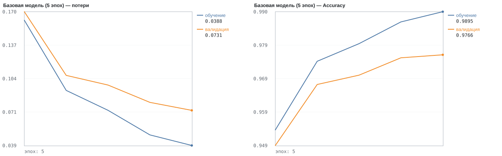
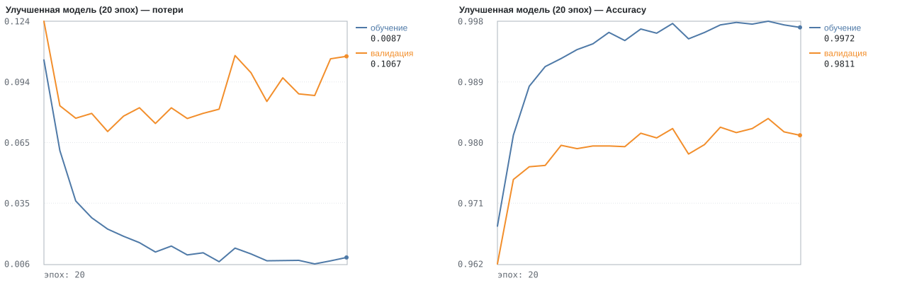
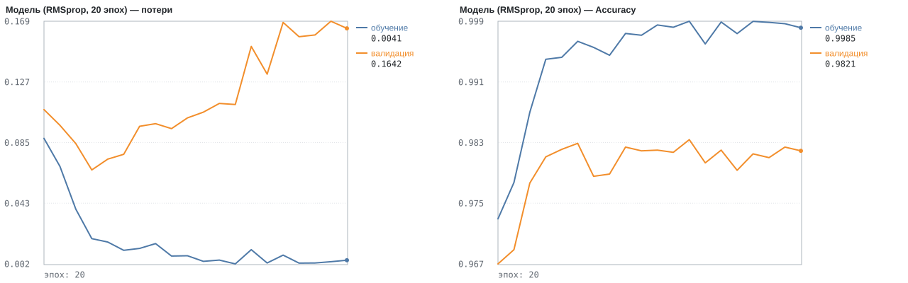
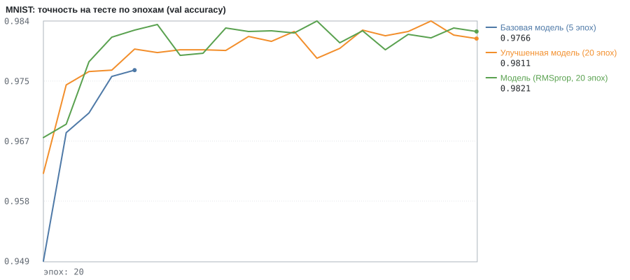
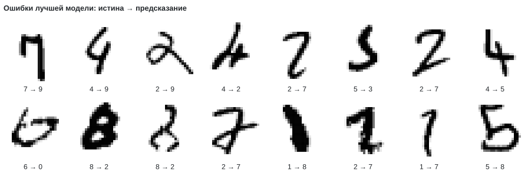

# Лабораторная: классификация изображений MNIST (рукописные цифры)

## 3. Загрузка и анализ данных

Файлы IDX: пользовательский кэш IrisNeuralNet/datasets/mnist (скачиваются при первом запуске, проверка SHA-256).

Форма обучающих изображений: (60000, 28, 28), меток: (60000,); тестовых: (10000, 28, 28) и (10000,).

Пример меток: [5 0 4 1 9 2 1 3 1 4]

```
Пример изображения: 5
                                                        
                                                        
                                                        
                                                        
                                                        
                                ==++**..**@@@@==        
                ....--****@@@@@@@@@@%%**@@@@##::        
              ..@@@@@@@@@@@@@@@@@@@@------::..          
                %%@@@@@@@@@@####@@@@                    
                --**==@@@@%%    ..**                    
                      **@@--                            
                      ++@@##                            
                        ##@@::                          
                        ..@@%%**==                      
                          --@@@@@@==                    
                            ..##@@@@++..                
                                --@@@@##                
                                  @@@@@@::              
                            ..++##@@@@%%                
                        ..++%%@@@@@@@@##                
                      ==%%@@@@@@@@##--                  
                  ::%%@@@@@@@@##--                      
              **%%@@@@@@@@##--                          
        ::**%%@@@@@@@@@@++                              
        ++@@@@@@%%++++                                  
                                                        
                                                        
                                                        
```




## 4. Предобработка данных

a) Flatten: 28×28 → вектор 784; нормализация ÷255 → диапазон значений пикселей [0, 1].

b) One-hot: обучение (60000, 10), тест (10000, 10); метка 5 → [0, 0, 0, 0, 0, 1, 0, 0, 0, 0].


## 5–7. Базовая модель: Flatten → Dense(256, relu) → Dense(10, softmax), adam

**Базовая модель (5 эпох)**: скрытые слои [256], optimizer='adam' (lr 0.001), loss: multi-class (softmax + categorical CE), epochs=5, batch_size=128, признаки: ÷255 (пиксели)

```
_________________________________________________________________
 Layer (type)                  Output Shape        Param #
=================================================================
 flatten (Flatten)             (None, 784)         0
 dense (Dense, relu)           (None, 256)         200,960
 dense_1 (Dense, softmax)      (None, 10)          2,570
=================================================================
Total params: 203,530
Trainable params: 203,530
Non-trainable params: 0
_________________________________________________________________
```

evaluate (валидация/тест): loss 0.0731, accuracy 97.7 %; train: loss 0.0388, accuracy 99.0 %; время 15.5 с




## 8. Эксперимент: поиск модели с точностью ≥ 95%

**Улучшенная модель (20 эпох)**: скрытые слои [512, 256], optimizer='adam' (lr 0.001), loss: multi-class (softmax + categorical CE), epochs=20, batch_size=128, признаки: ÷255 (пиксели)

```
_________________________________________________________________
 Layer (type)                  Output Shape        Param #
=================================================================
 flatten (Flatten)             (None, 784)         0
 dense (Dense, relu)           (None, 512)         401,920
 dense_1 (Dense, relu)         (None, 256)         131,328
 dense_2 (Dense, softmax)      (None, 10)          2,570
=================================================================
Total params: 535,818
Trainable params: 535,818
Non-trainable params: 0
_________________________________________________________________
```

evaluate (валидация/тест): loss 0.1067, accuracy 98.1 %; train: loss 0.0087, accuracy 99.7 %; время 172.3 с



Цель достигнута: точность 98.11 % ≥ 95%.


## 9. Эксперимент: другой оптимизатор (RMSprop)

**Модель (RMSprop, 20 эпох)**: скрытые слои [512, 256], optimizer='rmsprop' (lr 0.001), loss: multi-class (softmax + categorical CE), epochs=20, batch_size=128, признаки: ÷255 (пиксели)

evaluate (валидация/тест): loss 0.1642, accuracy 98.2 %; train: loss 0.0041, accuracy 99.9 %; время 167.5 с



Сравнение точностей: улучшенная модель (Adam): 98.11 %; модель (RMSprop): 98.21 %.


## 10. Классификация пользовательского изображения (демонстрация)

Тестовое изображение #0: истинная метка 7, предсказанная 7, уверенность 100.00 % (модель «Модель (RMSprop, 20 эпох)»).

```
                                                        
                                                        
                                                        
                                                        
                                                        
                                                        
                                                        
            --##**++::..                                
            %%@@@@@@@@@@################**::            
            ::==::==**%%@@%%@@@@@@@@%%@@@@++            
                        ::  ::::::::  @@@@==            
                                    --@@%%              
                                    @@@@--              
                                  ++@@@@..              
                                ::@@@@::                
                                ++@@##                  
                                %%@@::                  
                              ==@@##                    
                            ::@@@@::                    
                            %%@@**                      
                          ##@@%%..                      
                        ..@@@@--                        
                      ..%%@@==                          
                      ++@@@@::                          
                    ::@@@@@@::                          
                    ==@@@@%%..                          
                    ==@@%%                              
                                                        
```


## 11. Сравнение и анализ результатов

| Модель | Архитектура | Оптимизатор | Эпох | Batch | Параметров | train accuracy | val accuracy | лучшая val accuracy (эпоха) | мин. val_loss (эпоха) | Время |
|---|---|---|---|---|---|---|---|---|---|---|
| Базовая модель (5 эпох) | 784 → 256 → 10 | adam | 5 | 128 | 203,530 | 99.0 % | 97.7 % | 97.7 % (5) | 0.0731 (5) | 15.5 с |
| Улучшенная модель (20 эпох) | 784 → 512 → 256 → 10 | adam | 20 | 128 | 535,818 | 99.7 % | 98.1 % | 98.4 % (18) | 0.0701 (5) | 172.3 с |
| Модель (RMSprop, 20 эпох) | 784 → 512 → 256 → 10 | rmsprop | 20 | 128 | 535,818 | 99.9 % | 98.2 % | 98.4 % (13) | 0.0664 (4) | 167.5 с |



- Эпохи и архитектура: «Улучшенная модель (20 эпох)»: val accuracy 98.1 % против 97.7 % у «Базовая модель (5 эпох)» (+0.5 п.п., лучше); время 172.3 с против 15.5 с.
- Adam vs RMSprop: «Модель (RMSprop, 20 эпох)»: val accuracy 98.2 % против 98.1 % у «Улучшенная модель (20 эпох)» (+0.1 п.п., лучше); время 167.5 с против 172.3 с.
- Базовая модель (5 эпох): явных признаков переобучения нет: val_loss к концу обучения у своего минимума; разрыв accuracy train−val 1.3 п.п.
- Улучшенная модель (20 эпох): переобучение: val_loss минимален на эпохе 5 (0.0701), в последних 3 эпохах в среднем выше на 43 %; разрыв accuracy train−val 1.6 п.п.
- Модель (RMSprop, 20 эпох): переобучение: val_loss минимален на эпохе 4 (0.0664), в последних 3 эпохах в среднем выше на 147 %; разрыв accuracy train−val 1.6 п.п.

Матрица ошибок лучшей модели «Модель (RMSprop, 20 эпох)» на 10000 тестовых изображениях (ошибок: 179):

| истина \ предсказано | 0 | 1 | 2 | 3 | 4 | 5 | 6 | 7 | 8 | 9 | точность класса |
|---|---|---|---|---|---|---|---|---|---|---|---|
| 0 | 971 | 1 | 0 | 1 | 0 | 1 | 4 | 1 | 1 | 0 | 99.1 % |
| 1 | 0 | 1123 | 1 | 1 | 0 | 0 | 2 | 5 | 3 | 0 | 98.9 % |
| 2 | 1 | 0 | 1007 | 6 | 1 | 0 | 2 | 9 | 5 | 1 | 97.6 % |
| 3 | 0 | 0 | 1 | 993 | 0 | 2 | 0 | 4 | 5 | 5 | 98.3 % |
| 4 | 1 | 0 | 4 | 1 | 956 | 1 | 5 | 3 | 2 | 9 | 97.4 % |
| 5 | 2 | 0 | 0 | 7 | 1 | 869 | 3 | 0 | 7 | 3 | 97.4 % |
| 6 | 2 | 2 | 0 | 1 | 1 | 1 | 950 | 0 | 1 | 0 | 99.2 % |
| 7 | 1 | 0 | 5 | 0 | 0 | 0 | 0 | 1014 | 3 | 5 | 98.6 % |
| 8 | 2 | 1 | 3 | 5 | 1 | 1 | 2 | 4 | 953 | 2 | 97.8 % |
| 9 | 3 | 2 | 0 | 4 | 6 | 1 | 2 | 6 | 0 | 985 | 97.6 % |



Модель «Модель (RMSprop, 20 эпох)» сохранена в mnist_best.nn (2,149,616 байт, нормализатор внутри) и загружена заново: val accuracy на сырых признаках = 98.2 % — совпадает с исходной моделью.

