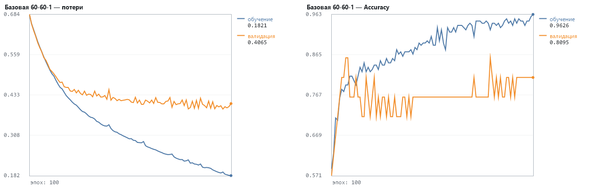
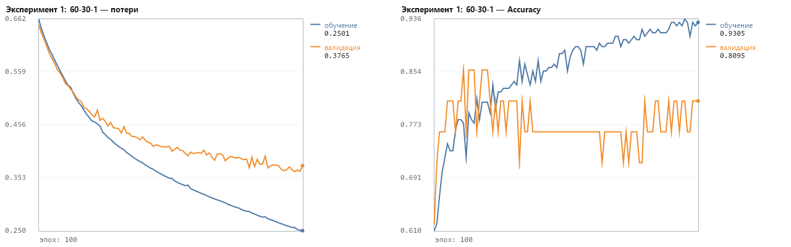
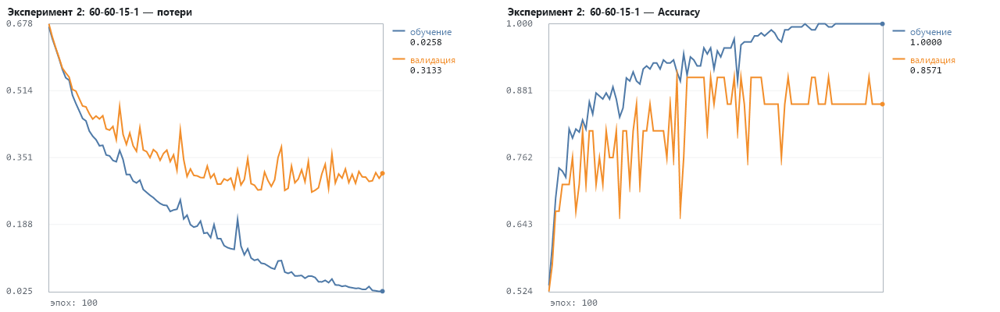
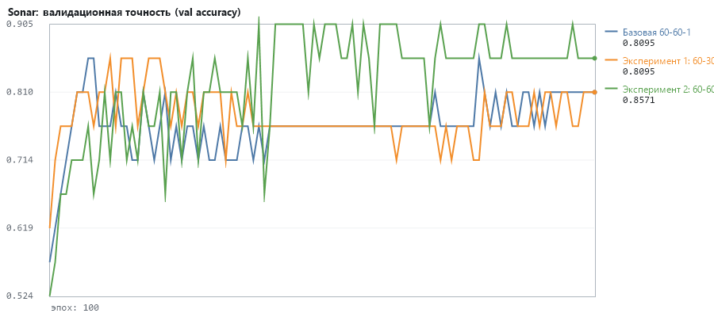

# Лабораторная: бинарная классификация сигналов радара (Sonar)

## 3. Загрузка и анализ данных

dataframe.shape: (208, 61) → X: (208, 60), Y_labels: (208,)

Уникальные метки: ['M' 'R']; камней (R): 97, металла (M): 111 — классы почти сбалансированы.

```
head(): первые 5 признаков
0.0200, 0.0371, 0.0428, 0.0207, 0.0954, ... , R
0.0453, 0.0523, 0.0843, 0.0689, 0.1183, ... , R
0.0262, 0.0582, 0.1099, 0.1083, 0.0974, ... , R
0.0100, 0.0171, 0.0623, 0.0205, 0.0205, ... , R
0.0762, 0.0666, 0.0481, 0.0394, 0.0590, ... , R
```


## 4. Предобработка данных

Кодирование меток: R → 0, M → 1 (как в методичке; sklearn.LabelEncoder отсортировал бы ['M', 'R'] и дал M → 0 — на качество не влияет). One-hot не нужен: sigmoid + binary_crossentropy работают с меткой 0/1 напрямую.

Закодированные метки (первые 10): [0 0 0 0 0 0 0 0 0 0]

validation_split=0.1 → train 187 / val 21. Файл отсортирован (сначала все R, потом все M), поэтому строки перемешиваются: Keras взял бы последние 10% — одни «M». Признаки уже в [0, 1], нормализация не нужна. Инициализация весов — Glorot uniform (умолчание Keras) вместо kernel_initializer='normal' из листинга.


## 5–7. Базовая модель 60 → 60 → 1 (relu, sigmoid), adam, binary_crossentropy

**Базовая 60-60-1**: скрытые слои [60], optimizer='adam' (lr 0.001), loss: binary (sigmoid + binary CE), epochs=100, batch_size=10, признаки: без нормализации

```
_________________________________________________________________
 Layer (type)                  Output Shape        Param #
=================================================================
 dense (Dense, relu)           (None, 60)          3,660
 dense_1 (Dense, sigmoid)      (None, 1)           61
=================================================================
Total params: 3,721
Trainable params: 3,721
Non-trainable params: 0
_________________________________________________________________
```

evaluate (валидация/тест): loss 0.4065, accuracy 81.0 %; train: loss 0.1821, accuracy 96.3 %; время 0.12 с




## 8. Эксперимент 1: уменьшенный первый скрытый слой (60 → 30 → 1)

**Эксперимент 1: 60-30-1**: скрытые слои [30], optimizer='adam' (lr 0.001), loss: binary (sigmoid + binary CE), epochs=100, batch_size=10, признаки: без нормализации

```
_________________________________________________________________
 Layer (type)                  Output Shape        Param #
=================================================================
 dense (Dense, relu)           (None, 30)          1,830
 dense_1 (Dense, sigmoid)      (None, 1)           31
=================================================================
Total params: 1,861
Trainable params: 1,861
Non-trainable params: 0
_________________________________________________________________
```

evaluate (валидация/тест): loss 0.3765, accuracy 81.0 %; train: loss 0.2501, accuracy 93.0 %; время 0.05 с




## 9. Эксперимент 2: дополнительный скрытый слой (60 → 60 → 15 → 1)

**Эксперимент 2: 60-60-15-1**: скрытые слои [60, 15], optimizer='adam' (lr 0.001), loss: binary (sigmoid + binary CE), epochs=100, batch_size=10, признаки: без нормализации

```
_________________________________________________________________
 Layer (type)                  Output Shape        Param #
=================================================================
 dense (Dense, relu)           (None, 60)          3,660
 dense_1 (Dense, relu)         (None, 15)          915
 dense_2 (Dense, sigmoid)      (None, 1)           16
=================================================================
Total params: 4,591
Trainable params: 4,591
Non-trainable params: 0
_________________________________________________________________
```

evaluate (валидация/тест): loss 0.3133, accuracy 85.7 %; train: loss 0.0258, accuracy 100.0 %; время 0.13 с




## 10. Сравнение моделей и анализ результатов

| Модель | Архитектура | Оптимизатор | Эпох | Batch | Параметров | train accuracy | val accuracy | лучшая val accuracy (эпоха) | мин. val_loss (эпоха) | Время |
|---|---|---|---|---|---|---|---|---|---|---|
| Базовая 60-60-1 | 60 → 60 → 1 | adam | 100 | 10 | 3,721 | 96.3 % | 81.0 % | 85.7 % (8) | 0.3895 (96) | 0.12 с |
| Эксперимент 1: 60-30-1 | 60 → 30 → 1 | adam | 100 | 10 | 1,861 | 93.0 % | 81.0 % | 85.7 % (12) | 0.3649 (97) | 0.05 с |
| Эксперимент 2: 60-60-15-1 | 60 → 60 → 15 → 1 | adam | 100 | 10 | 4,591 | 100.0 % | 85.7 % | 90.5 % (39) | 0.2676 (79) | 0.13 с |



- «Эксперимент 1: 60-30-1»: val accuracy 81.0 % против 81.0 % у «Базовая 60-60-1» (0.0 п.п., без изменений); время 0.05 с против 0.12 с.
- «Эксперимент 2: 60-60-15-1»: val accuracy 85.7 % против 81.0 % у «Базовая 60-60-1» (+4.8 п.п., лучше); время 0.13 с против 0.12 с.
Переобучение (разрыв между loss и val_loss):

- Базовая 60-60-1: явных признаков переобучения нет: val_loss к концу обучения у своего минимума; разрыв accuracy train−val 15.3 п.п.
- Эксперимент 1: 60-30-1: явных признаков переобучения нет: val_loss к концу обучения у своего минимума; разрыв accuracy train−val 12.1 п.п.
- Эксперимент 2: 60-60-15-1: слабые признаки переобучения: после эпохи 79 val_loss вырос в среднем на 14 %; разрыв accuracy train−val 14.3 п.п.
Валидационная выборка мала (21 шт.): один образец = 4.8 п.п. точности, поэтому разница в 1–2 образца между моделями — шум. Ниже — более надёжная оценка 5-fold перекрёстной проверкой.


## Дополнительно: 5-fold перекрёстная проверка тех же архитектур

| Модель | Средняя val accuracy | Разброс (σ) по блокам | Блоки |
|---|---|---|---|
| Базовая 60-60-1 | 82.4 % | 8.1 п.п. | 71 % 88 % 85 % 93 % 76 % |
| Эксперимент 1: 60-30-1 | 83.4 % | 6.1 п.п. | 73 % 88 % 85 % 90 % 80 % |
| Эксперимент 2: 60-60-15-1 | 84.9 % | 5.9 п.п. | 80 % 90 % 88 % 90 % 76 % |

**Вывод.** По одной валидационной выборке лучшая — «Эксперимент 2: 60-60-15-1» (85.7 %); по перекрёстной проверке — «Эксперимент 2: 60-60-15-1» (в среднем 84.9 %). Перекрёстная оценка надёжнее: она усредняет 5 разбиений с валидацией по ~41 шт.

Модель «Эксперимент 2: 60-60-15-1» сохранена в sonar_best.nn (18,428 байт, нормализатор внутри) и загружена заново: val accuracy на сырых признаках = 85.7 % — совпадает с исходной моделью.

